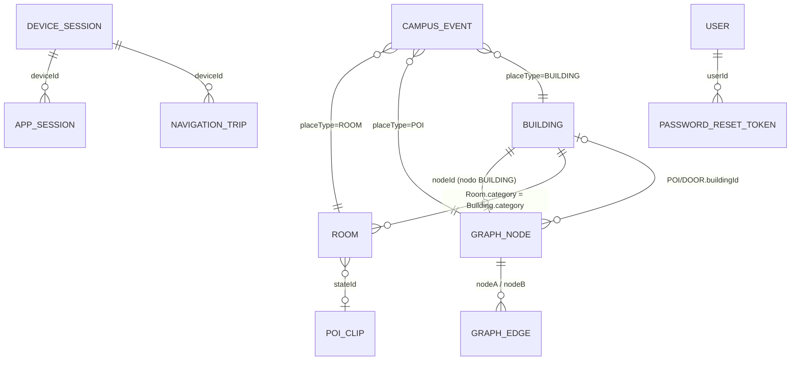

# Backend UCO MAP: base de datos (MongoDB)

- Spring Data MongoDB, URI en `MONGODB_URI` (`spring.data.mongodb.uri`). Producción: MongoDB Atlas.
- Local: `docker run -d --name ucomap-mongo -p 27017:27017 mongo:7` y `MONGODB_URI=mongodb://localhost:27017/ucomap`.
- **No hay migraciones.** Los documentos viejos conservan su forma; los campos nuevos deben aceptar `null`.

## Colecciones (`src/main/java/co/edu/uco/ucomap/model`)

| Colección | Clase | Id | Campos clave |
|---|---|---|---|
| `buildings` | `Building` | `buildingId` | `label`, `color`, `category`, `gps`, `nodeId`, `active` |
| `rooms` | `Room` | `id` | `roomId` (único), `name`, `category` (= `Building.category`, p. ej. `CO`, `EDC`), `stateId`, `modelUrl`, `arPosition {x,y,z}`, `floor`, `active` |
| `graph_nodes` | `GraphNode` | `nodeId` | `gps`, `label`, `nodeType` (`BUILDING`, `ENTRANCE`, `DOOR`, `WAYPOINT`, `POI`), `poiType`, `buildingId`, `floor`, `active` |
| `graph_edges` | `GraphEdge` | `id` | `nodeA`, `nodeB` (no dirigidas), `active` |
| `poi_clips` | `PoiClip` | `clipId` | `displayName`, `active` (nombres heredados de la escena AR anterior) |
| `app_settings` | `AppSetting` | `key` | `value` (string), `type` (`BOOLEAN`, `STRING`, `NUMBER`, `JSON`), `description`, `category`, `active` |
| `campus_events` | `CampusEvent` | `id` | `title`, `placeType` (`ROOM`, `POI`, `BUILDING`), `placeId`, `placeNote`, `startsAt`, `endsAt`, `active` |
| `device_sessions` | `DeviceSession` | `id` | `deviceId` (único), plataforma, modelo, SO, idioma, `firstSeen`, `lastSeen`, contadores, `permissions`, `arCapability` |
| `app_sessions` | `AppSession` | `id` | `sessionId` (único, una visita), `deviceId`, `startedAt`, `activeMs`, `features` (mapa), `permissions` |
| `navigation_trips` | `NavigationTrip` | `id` | `tripId` (único), `deviceId`, `roomId`, `building`, `status` (`IN_PROGRESS`, `ARRIVED`, `ABANDONED`), `endReason`, tiempos, distancias, `usedAR`, `vpsCalls`, `transition`, `arPerf` |
| `users` | `User` | `id` | `email` (único), `passwordHash` (BCrypt), `role` (`ADMIN`), `active`, `passwordChangedAt` |
| `password_reset_tokens` | `PasswordResetToken` | `id` | `userId`, `tokenHash` (SHA-256, único), `expiresAt`, `used`, `revoked` |
| `nav_meshes` | `NavMeshData` | `id` (documento único) | binario del navmesh, `updatedAt`, `updatedBy` |
| `nav_patches` | `NavPatch` | `id` | `label`, `points` (polígono de piso transitable añadido a mano) |
| `nav_connections` | `NavConnection` | `id` | `label`, `group`, `start`, `end`, `radius`, `bidirectional` (escaleras, rampas) |
| `nav_elevators` | `NavElevator` | `id` | `label`, `building`, `stops` |
| `nav_blocks` | `NavBlock` | `id` | `kind` (`AREA`, `BARRIER`, `CONNECTION`), `polygons`, `line`, `connectionId` |
| `scan_edits` | `ScanEdit` | `id` | `meshes` (triángulos quitados del escaneo), `center`, `triangleCount` |

## Relaciones (por convención, sin claves foráneas)

- `BuildingNodeSync` mantiene **1:1** cada `Building` activo con un nodo `BUILDING` (crear/mover/ocultar). Al
  borrar un nodo de grafo se usa `active=false`; `GraphService` filtra aristas cuyos extremos no están activos.
- `Room.arPosition` y todos los `ArPoint` están en el **espacio del map set del VPS propio** (metros). Si cambia el
  map set (`VPS_MAP_SET_ID`) hay que rehacer puntos AR, parches, conexiones y el navmesh.

## Índices

Los crea `common/config/MongoIndexInitializer.java` al arrancar (desactivable con `app.mongo.ensure-indexes=false`;
si falla solo registra una advertencia): únicos en `device_sessions.deviceId`, `app_sessions.sessionId`,
`navigation_trips.tripId`, `users.email`, `password_reset_tokens.tokenHash`; además índices de fecha/estado para
analítica y `graph_edges.nodeA/nodeB`, `campus_events.endsAt`.

Las anotaciones `@Indexed` de los modelos (`Room.roomId`, `Building`, `GraphNode`) **no se aplican solas**:
`spring.data.mongodb.auto-index-creation` no está activado (en Spring Data MongoDB 3+ es `false` por defecto).
Si necesitas un índice, agrégalo en `MongoIndexInitializer`.

## Siembra (`app.data.init-on-startup=true`)

- `DataInitializerService`: si una colección está vacía siembra datos de ejemplo (en una base nueva: 20 nodos,
  20 aristas, 4 edificios, 21 salones, 21 clips). No reemplaza datos existentes.
- `AppSettingInitializer`: `enableIndoorARNavigation` y `arOnLimitedDevices` (`true`) si faltan.
- `AdminInitializer`: usuario `admin@admin.com` si no existe (contraseña fija en el código: cámbiala tras el primer ingreso en cualquier entorno compartido).

Para datos reales en local pide al responsable un volcado (`mongodump`/`mongorestore`) o credenciales de solo lectura.

## Buenas prácticas

- Escrituras concurrentes o parciales: usa `MongoTemplate` con `Query`/`Update` (ver heartbeats en
  `NavigationTripService`) en vez de leer-modificar-guardar.
- Paginación en servidor con `PageResponse` y tamaño máximo 100 (`/api/sessions`, `/api/trips`).
- No guardes binarios grandes en documentos: el navmesh está limitado a 5 MB (`NavigationService.MAX_NAVMESH_BYTES`)
  y MongoDB a 16 MB por documento.
- Nunca ejecutes scripts de escritura contra producción sin respaldo y autorización del responsable.
